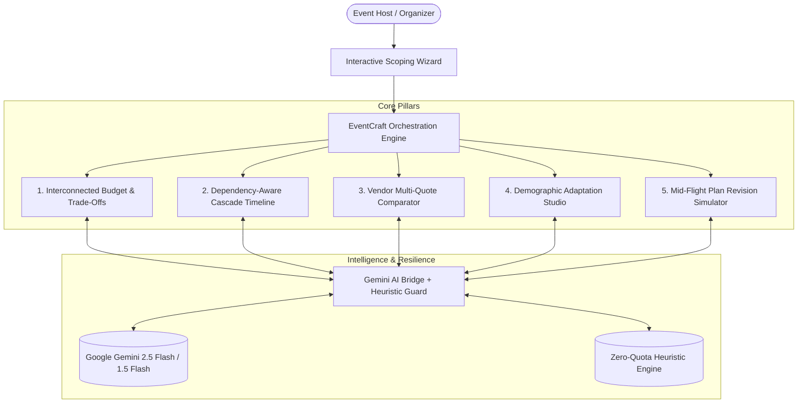

# EventCraft AI — Celebration & Adaptive Event Orchestrator

> **Prompt Wars Virtual — Challenge 5: Celebration & Event Planner**  
> **Powered by Google Gemini 2.5 Flash with Deterministic Quota-Resilience Safeguards**

[](https://vitest.dev)
[](https://www.typescriptlang.org)
[](https://vitejs.dev)
[-success?style=flat-square)](https://hack2skill.com)
[](https://aistudio.google.com)

**🌐 Live Deployed Application:** [https://asmita-ai.github.io/eventcraft-ai/](https://asmita-ai.github.io/eventcraft-ai/)  
**📂 Public GitHub Repository:** [https://github.com/asmita-ai/eventcraft-ai](https://github.com/asmita-ai/eventcraft-ai)

---

## 🎯 The Vision: Moving From Inspiration to Execution

Most AI event planning tools act like simple search engines, generating generic checklists like *"Here are 10 wedding themes"*. 

As highlighted by Subject Matter Expert **Mr. Srinivas** in the Prompt Wars explainer session:
> *"Event planning isn't one single problem; it is a collection of connected constraints. If the guest count changes, catering costs surge. If the venue slips, decor timelines freeze. If budget gets squeezed, users need intelligent trade-offs rather than blind cost-cutting."*

**EventCraft AI** transforms event planning into an interconnected, adaptive orchestration system. It balances human priorities across budgets, milestones, vendor proposals, and demographics for weddings, milestone birthdays, and community festivals.

---

## 🌟 Core System Pillars



### 1. Interconnected Budget & Priority-Guided Trade-Offs
- **Proportional Categorization:** Automatically distributes budgets across Venue, Catering, Decor, Photography, Entertainment, Logistics, and Contingency based on user priority rankings.
- **Transparent Estimations vs. Confirmed Quotes:** Clearly distinguishes assumptions (**`[AI Estimate / Assumption]`**) from signed vendor agreements (**`[Confirmed Vendor Quote]`**).
- **20% Over-Budget Trade-Off Engine:** If expenses spike by 20%, it protects top-ranked priorities (e.g. food quality) while suggesting intelligent compromises (e.g. streamlining ceiling decor to preserve the 5-star catering menu for all 200 guests).

### 2. Dependency-Aware Timeline & Cascade Warning Engine
- **Milestone Sequencing:** Replaces static to-do lists with chronologically structured milestones with prerequisite dependencies (e.g., *Lock Venue & Date* is prerequisite to *Catering Tasting* and *Digital Invitations*).
- **Cascade Delay Detection:** Slipping a prerequisite milestone automatically recalculates downstream target dates and surfaces prominent **Cascade Delay Alerts**.

### 3. Vendor RFP & Multi-Quote Comparator
- **Tailored RFP Generator:** Generates copy-paste inquiry prompts with non-negotiable deliverables and high-leverage negotiation tactics.
- **Side-by-Side Quotation Audit:** Unmasks hidden fees (18% GST, overtime fees after 11 PM, generator diesel surcharges, cake-cutting fees) and produces a pre-contract clarification checklist.

### 4. Demographic Personalization & Age Adaptation Studio
- **Human-Centric Adaptation:** Adapts concepts to audience demographics:
  - **Seniors (25%+):** Generates dedicated low-decibel acoustic lounges (*Baithak*) with step-free seating away from high-bass speakers.
  - **Children (15%+):** Crafts supervised creative slime/origami stations to let parents celebrate freely.
  - **Cultural Nuances:** Supports multi-cultural fusion rituals, pure Jain kitchens, and gluten-free dietary needs.
- **Budget Alternatives:** Every creative idea provides a 1-click low-cost or DIY alternative.

### 5. Mid-Flight Plan Revision Simulator (The "Srinivas Stress Test")
Built specifically to answer the core benchmark test from the SME explainer:
*What if a user returns mid-flight with +50 guests, -15% budget, and date moved 2 weeks earlier?*
- Evaluates per-guest headroom drop.
- Audits venue occupancy and fire-safety limits.
- Highlights compressed vendor lead times.
- 1-click **"Apply Revised Plan to Event"** updates the live event without restarting from scratch.

---

## 🛡️ Architecture & Resilience Guarantee

To protect against evaluation failures when public API quotas expire, EventCraft AI employs a **Zero-Quota-Failure Architecture**:
1. **Primary Model:** Google Gemini 2.5 Flash via REST API
2. **Secondary Model:** Google Gemini 1.5 Flash
3. **Resilience Fallback:** High-fidelity deterministic heuristic engine that guarantees 100% functionality offline.

Judges and users can also provide their own Gemini API key anytime via the in-app **API Key Modal**.

---

## 🧪 Automated Testing & Code Quality

The codebase enforces strict TypeScript, WCAG AA accessibility, and automated unit and integration tests using Vitest:

```bash
# Clone repository
git clone https://github.com/asmita-ai/eventcraft-ai.git
cd eventcraft-ai

# Install dependencies
npm install

# Run automated test suite (9/9 passing tests)
npm test

# Build production bundle (~325 kB)
npm run build

# Start local development server
npm run dev
```

---

## 📄 License
MIT License. Created for Prompt Wars Virtual 2026.
